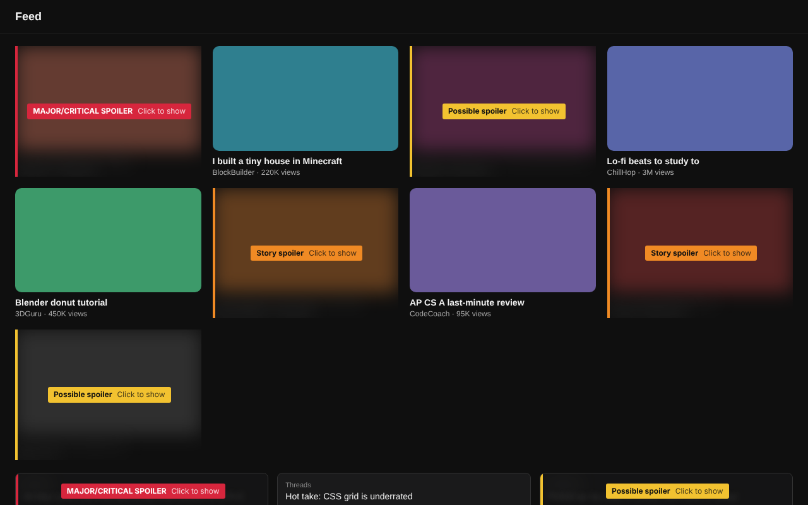
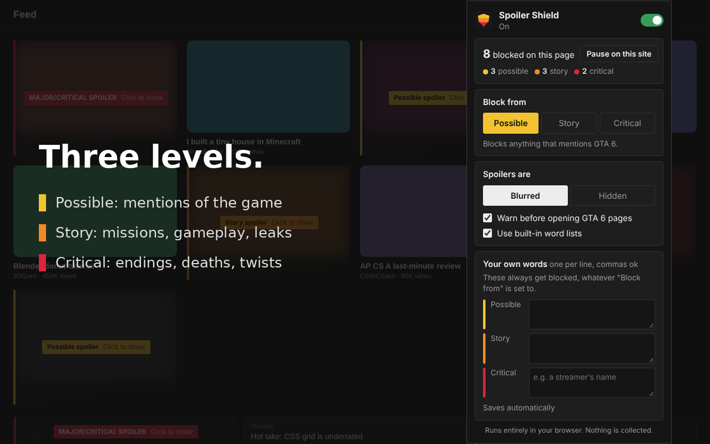

# Spoiler Shield: GTA 6

A Chrome extension that blurs GTA 6 spoilers on YouTube, TikTok, Instagram, X, Reddit and other social media sites, so you can scroll safely until you've played it yourself.



## Features

- **Three spoiler levels**, each with its own color:
  - **Possible spoiler** (yellow): anything that mentions the game
  - **Story spoiler** (orange): missions, gameplay, leaks
  - **MAJOR/CRITICAL SPOILER** (red): endings, deaths, twists
- **Pick your limit:** block everything, or only story details, or only critical spoilers
- **Click to show** any blurred post, or switch to Hide mode to remove spoilers completely
- **Warning screen** before you open a page that's about GTA 6
- **Your own words** at any level (a streamer, a mission name, a friend who spoils things). These are always blocked.
- **Pause on any site** with one click
- **Toolbar badge** with the number of blocked items, colored by the worst level on the page



## Supported sites

YouTube (including Shorts and live chat), TikTok, Instagram, X/Twitter, Reddit, Facebook, Threads, Bluesky, Tumblr, LinkedIn, Pinterest, Mastodon, Twitch, Kick, Discord, Telegram Web, WhatsApp Web, Steam Community, Google Search, and regular websites.

## Install

**From the Chrome Web Store:** coming soon.

**Download (Chrome, Edge, Brave, Opera):**

1. **[Download spoiler-shield-gta6.zip](https://github.com/flicer0128/spoiler-shield-gta6/releases/latest/download/spoiler-shield-gta6.zip)**
2. Unzip it. You'll get a folder called `spoiler-shield-gta6`. Move it somewhere permanent, like Documents.
3. Go to `chrome://extensions` and turn on **Developer mode** (top right).
4. Click **Load unpacked** and select the `spoiler-shield-gta6` folder.
5. Pin Spoiler Shield from the puzzle-piece menu.

All versions are on the [Releases page](https://github.com/flicer0128/spoiler-shield-gta6/releases).

Keep the folder where it is; Chrome loads the extension from it. To update, download the new zip, replace the folder, and click the reload arrow on the extension in `chrome://extensions`.

## How detection works

Every post is rated using the word lists in [`WORD_LIST.md`](WORD_LIST.md):

- A yellow word (like "GTA 6", "Leonida" or "Jason Duval") is needed to trigger a block.
- Orange or red words in the same post raise the level. On their own, words like "ending" or "mission" are ignored, so unrelated posts aren't blurred.
- "No spoilers" and "spoiler-free" don't count as critical.
- Your own words always trigger at the level you put them in.

It only reads text. Spoilers that appear only in an image or video, with no caption or title, can't be detected.

## Privacy

Everything runs locally in your browser. The extension makes no network requests, has no analytics, and collects no data. Settings are stored with Chrome's built-in sync storage. See the [privacy policy](docs/privacy.md).

## Project structure

```
extension/       The extension itself (load this folder in Chrome)
  manifest.json
  content.js     Finds, rates and blurs spoilers on each page
  content.css    Blur, labels and warning screen styles
  defaults.js    Word lists and default settings
  popup.*        Settings popup
  background.js  Toolbar badge
store-listing/   Chrome Web Store text and graphics
docs/            Screenshots and privacy policy
```

## Contributing

Spotted a spoiler that got through, or a site where blurring breaks? Open an issue with the site and an example of the text. Pull requests that add words to `extension/defaults.js` or containers for new sites are welcome.

## Disclaimer

Spoiler Shield is a fan-made tool and is not affiliated with, endorsed by, or sponsored by Rockstar Games or Take-Two Interactive. "Grand Theft Auto" and "GTA" are trademarks of their respective owners.

## License

[MIT](LICENSE)
